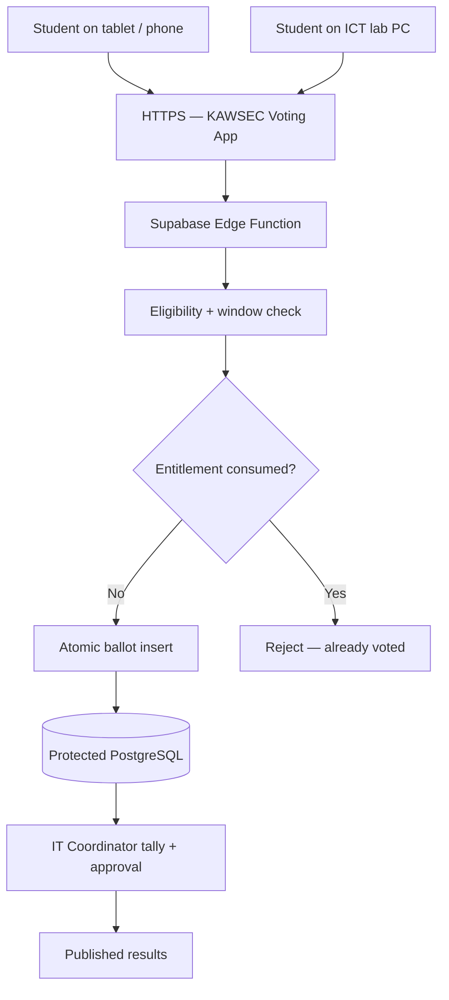

# KAWSEC Prefectorial Voting System — Development Roadmap

> **Project:** Secure web-based prefectorial election management system for Nkawkaw Senior High School (KAWSEC), Ghana
> **Status:** Active development — not approved for live elections until school authorisation, security review and mock-election sign-off.

---

## 1. Project Objective

Build a tablet-first, accessible digital voting platform for school prefect elections at KAWSEC (Nkawkaw Senior High School). Students authenticate with their Student ID and a system-generated voting credential, then cast votes position by position. The 40 ICT lab computers serve as supervised voting stations; students may also vote on personal devices over school Wi-Fi or mobile data. Changing devices or networks must never grant another vote.

### Users and Responsibilities

| Role | Responsibilities |
|---|---|
| **Student voter** | Authenticate with Student ID + voting credential, inspect candidates and manifestos, cast a private ballot for each eligible position, receive a non-revealing confirmation |
| **Election officer** | Verify the student register, manage nominations and candidates, monitor aggregate turnout, handle documented incidents |
| **IT Coordinator** | Configure elections, schedules and positions; approve and publish results; oversee audit logs; generate official PDF reports |
| **Public visitor** | View officially published results only |

---

## 2. Confirmed Election Rules (Phase 0 Decisions)

### 2.1 Prefect Positions
Every position is held by **one boy and one girl** — voters cast separate ballots for the male and female contest of each position:

| Position | Male Role | Female Role |
|---|---|---|
| School Prefect | Head Boy | Head Girl |
| Compound Prefect | Compound Prefect (M) | Compound Prefect (F) |
| Sports Prefect | Sports Prefect (M) | Sports Prefect (F) |
| House Captain | House Captain (M) | House Captain (F) |
| School Chaplain | School Chaplain (M) | School Chaplain (F) |
| Entertainment Prefect | Entertainment Prefect (M) | Entertainment Prefect (F) |
| Dining Hall Prefect | Dining Hall Prefect (M) | Dining Hall Prefect (F) |

**Total ballot positions: 14** (7 roles × 2 genders)

### 2.2 Eligibility
- **Whole-school positions** (all except House Captain): every registered student votes
- **House Captain**: only students belonging to that house vote for their house captain
- A student must vote in **every eligible position** — abstention is not permitted

### 2.3 Voting Method
- Students vote **position by position** (one screen per position)
- A ballot is only accepted after all eligible positions have been selected and confirmed

### 2.4 Ties
- Resolved by **panel decision** (IT Coordinator + Election Officer + School Management)
- Ties are flagged in the system; results are not published until a panel decision is recorded

### 2.5 Credentials
- Each student has a **Student ID** (school-issued; structured by department and class)
- On first access, the student enters their Student ID; the system **auto-generates a unique voting credential** and associates it with that student record
- Credentials are single-use per election; rate-limited; recoverable only through a supervised IT Coordinator reset

### 2.6 Concurrency
- Multiple students vote simultaneously; peak load = whole school in a supervised window
- The system must handle concurrent submissions without double-voting or data corruption

### 2.7 Result Publication
- The **IT Coordinator** reviews the tally and approves publication
- Candidate totals are hidden from everyone (including admins) during the voting window
- Admins see **aggregate turnout only** while voting is open
- Results go live only after IT Coordinator clicks "Publish Results"

---

## 3. Architecture and Technology

- **Frontend:** React, TypeScript, Vite, Tailwind CSS, React Router, Lucide React
- **Hosting:** Cloudflare Pages with HTTPS
- **Backend:** Supabase Edge Functions for sensitive operations (credential generation, ballot submission, result publication)
- **Database:** Supabase PostgreSQL with strict Row Level Security (RLS) and atomic transactions
- **School structure:** Students belong to a Department → Class hierarchy; houses are separate groupings
- **No offline ballot queuing** — all votes are live; students retry on connection failure



---

## 4. Non-Negotiable Security Requirements

1. School IT Coordinator and management sign off on candidate lists, eligibility rules, voting window and result publication policy before going live.
2. Use fictitious student records during development. Review Ghana Data Protection Act 2012 (Act 843) before importing real student data.
3. Authenticate voters with school-issued Student IDs and system-generated credentials. Store only protected credential verifiers (bcrypt/argon2). Rate-limit attempts; supervised recovery only.
4. Authorise every ballot **server-side** via an atomic transaction that consumes the entitlement and records the ballot in one operation.
5. **Ballot secrecy:** the `ballots` table must NOT contain the student's ID alongside their candidate choice. Participation (who voted) is separated from ballot choices (who they voted for). Table separation alone is not sufficient — a privacy/security review is required before production.
6. Do not show candidate totals during voting. IT Coordinator and admins see only aggregate turnout (total submitted / total eligible).
7. Do not permit arbitrary vote editing or deletion. All privileged actions are logged in a tamper-evident `audit_events` table.
8. Never rely on frontend controls, localStorage, IP address or device fingerprint to enforce election rules. Never expose the Supabase service-role key to the client.
9. Accessibility: clear text, large touch targets (min 44 × 44 px), keyboard navigation, WCAG AA contrast, responsive layout for tablets.
10. No production launch without a supervised mock election, independent tally reconciliation, threat review, IT Coordinator sign-off and a paper fallback plan.

---

## 5. Recommended Additional Features

| Feature | Purpose |
|---|---|
| **Bulk student import** | Upload student register via Excel/CSV with duplicate detection and preview |
| **Candidate photographs** | Help students identify contestants visually |
| **Candidate manifestos** | Let students review candidates' plans before voting |
| **Election scheduling** | Automatically open and close voting at set date/time |
| **Automatic vote counting** | Eliminate manual counting errors; tally runs on close |
| **Turnout dashboard** | Live participation monitoring without revealing candidate totals |
| **Audit logs** | Tamper-evident log of all privileged system actions |
| **Election results PDF** | Generate official signed-off PDF report for school records |
| **Backup and recovery** | Supabase point-in-time recovery + export before/after election |
| **Tablet-friendly UI** | Large cards, clear typography, minimal steps per screen |

---

## 6. Proposed Repository Structure

```text
KAWSEC_VOTING_SYSTEM/
├── docs/
│   ├── ROADMAP.md
│   ├── REQUIREMENTS.md
│   ├── THREAT_MODEL.md
│   ├── ELECTION_RULES.md
│   ├── TEST_PLAN.md
│   └── OPERATIONS.md
├── public/
│   └── images/
├── src/
│   ├── app/                    # routes, layout shell, error boundaries
│   ├── components/             # reusable accessible UI primitives
│   ├── features/
│   │   ├── auth/               # student credential auth flow
│   │   ├── students/           # student register, bulk import
│   │   ├── candidates/         # candidate cards, photos, manifestos
│   │   ├── elections/          # election lifecycle management
│   │   ├── positions/          # prefect positions + gender pairing
│   │   ├── houses/             # house groupings + house captain eligibility
│   │   ├── voting/             # ballot flow (position by position)
│   │   ├── admin/              # IT Coordinator dashboard, turnout, audit log
│   │   └── results/            # tally, publication, PDF export
│   ├── lib/                    # Supabase public client, helpers
│   ├── types/                  # TypeScript interfaces
│   ├── main.tsx
│   └── index.css
├── supabase/
│   ├── migrations/             # numbered SQL migration files
│   ├── functions/
│   │   ├── generate-credential/
│   │   ├── cast-ballot/
│   │   ├── publish-results/
│   │   └── export-pdf/
│   └── tests/
├── tests/
├── .env.example                # placeholders only — no secrets
└── package.json
```

---

## 7. Data Model

### Core Tables

```sql
-- School structure
departments (id, name, code)
classes (id, department_id, name, year_group)
houses (id, name, code)

-- Students (no passwords — credential verifiers stored separately)
students (id, student_id_number, full_name, class_id, house_id, gender, is_active)
credential_verifiers (id, student_id, verifier_hash, used_at, election_id)

-- Elections
elections (id, title, status [draft|approved|open|closed|verified|published|cancelled],
           voting_opens_at, voting_closes_at, created_by, approved_by)

-- Positions (e.g. "Head Boy", "Head Girl", "Sports Prefect M", "Sports Prefect F")
positions (id, election_id, title, gender_scope [male|female|all],
           eligibility_scope [school_wide|house], house_id nullable)

-- Candidates
candidates (id, position_id, student_id, photo_url, manifesto_text,
            status [pending|approved|rejected], approved_by)

-- Voting entitlements (one row per student per position they are eligible for)
voting_entitlements (id, election_id, student_id, position_id,
                     consumed_at nullable, UNIQUE(student_id, position_id))

-- Ballots (NO student_id here — separated from entitlements for secrecy)
ballots (id, election_id, position_id, candidate_id, submitted_at)

-- Audit log
audit_events (id, election_id, actor_id, action, details jsonb, created_at)

-- Published results (written only after IT Coordinator approval)
published_results (id, election_id, position_id, candidate_id, vote_count,
                   rank, tie_flag, published_at, published_by)
```

---

## 8. Delivery Phases

### Phase 0 — Discovery and Governance ✅ COMPLETE
- [x] Confirm prefect positions (7 roles × M/F = 14 ballot positions)
- [x] Confirm eligibility rules (school-wide vs house captain)
- [x] Confirm voting method (position by position, no abstention)
- [x] Confirm tie resolution (panel decision)
- [x] Confirm credential method (Student ID → auto-generated credential)
- [x] Confirm concurrency (multi-user simultaneous)
- [x] Confirm result publication (IT Coordinator approval)
- [x] Confirm additional features required

**Done ✅**

---

### Phase 1 — Repository and UI Foundation ✅ COMPLETE
- [x] Rename `package.json` name field to `kawsec-voting-system`
- [x] Migrate from `.jsx` to `.tsx` (TypeScript)
- [x] Install and configure Tailwind CSS (v4 via @tailwindcss/vite)
- [x] Create `src/types/` with core TypeScript interfaces
- [x] Build landing page: KAWSEC branding, 14 position cards, How It Works, CTA
- [x] Build student login UI: two-step Student ID → Credential
- [x] Build IT Coordinator login UI
- [x] Build public results page with demo data
- [x] Tablet-first responsive layout (mobile nav, responsive grids)
- [x] All ARIA and accessibility requirements met (skip links, aria-labels, aria-live)
- [x] Green & cream colour system consistent across all pages
- [x] Real school logo (logo.png) used throughout
- [x] All old reunion files deleted

**Done ✅**

---

### Phase 2 — Data Model and Access Controls ✅ COMPLETE
- [x] Write Supabase migrations for all tables listed in Section 7
  - `20260001_school_structure.sql` — departments, classes, houses
  - `20260002_students.sql` — students, credential_verifiers, credential_attempts
  - `20260003_elections.sql` — elections, positions, candidates + FK back to credential_verifiers
  - `20260004_voting.sql` — voting_entitlements, ballots, audit_events, published_results
- [x] Implement election lifecycle states (draft→approved→open→closed→verified→published→cancelled) with DB CHECK constraint
- [x] Configure RLS policies — ballots table has NO anon/auth SELECT; entitlements blocked from anon; credential_verifiers blocked from all direct API access
- [x] Ballot secrecy: ballots table has no student_id column by design
- [x] Seed fictitious students, departments, classes, houses (8 demo students, 6 houses, 6 departments)
- [x] Demo election seeded in 'draft' status with all 14 positions + house captain positions per house
- [x] Helper functions: get_election_turnout (no candidate totals), tally_election_results (service-role only)
- [x] TypeScript types updated in src/types/index.ts to match full schema
- [x] docs/ELECTION_RULES.md and docs/REQUIREMENTS.md written
- [ ] Verify RLS policies with Supabase policy tester (requires running migrations in Supabase dashboard)
- [ ] Confirm forbidden reads fail in practice after migrations are applied

**Done when:** forbidden reads/writes fail in automated permission tests.

---

### Phase 3 — Identity, Registration and Candidate Management
- [ ] Student ID lookup: enter Student ID → system generates + stores credential
- [ ] Rate limiting on credential generation (max 3 attempts per Student ID per 10 min)
- [ ] Bulk student import: CSV/Excel upload with preview, duplicate detection, validation
- [ ] Candidate submission: admin adds candidate with photo + manifesto
- [ ] Candidate approval workflow: pending → approved/rejected
- [ ] Eligibility table population: generate `voting_entitlements` rows when election is approved
- [ ] House captain eligibility: only students in that house get entitlement for that position

**Done when:** fictitious students can authenticate; officers cannot inspect ballot data.

---

### Phase 4 — Secure Voting Engine
- [ ] Position-by-position ballot UI: one candidate card screen per position
- [ ] Candidate cards: photo, name, manifesto preview
- [ ] Ballot review screen: show all selections before final confirm
- [ ] Supabase Edge Function `cast-ballot`: atomic entitlement consumption + ballot insert
- [ ] Idempotent retry: if network fails, re-submitting returns "already recorded" without double vote
- [ ] Election window enforcement: reject ballots outside `voting_opens_at / voting_closes_at`
- [ ] Completion screen: non-revealing confirmation (no candidate names shown)
- [ ] Prevent submission if any eligible position has no selection

**Done when:** concurrent requests, device switches, refreshes cannot produce extra ballots.

---

### Phase 5 — Administration, Tally and Reports
- [ ] Turnout dashboard: eligible count, submitted count, % turnout per position — no candidate totals
- [ ] Election scheduling: set open/close datetime; auto-transition on schedule
- [ ] Controlled closure: IT Coordinator closes election; tally computed server-side
- [ ] Tie detection: flag positions with tied counts; require panel decision input before publish
- [ ] IT Coordinator publish flow: review tally → record panel decisions for ties → publish
- [ ] PDF report generation: official election results with school letterhead
- [ ] Audit log viewer: searchable tamper-evident log of all admin actions
- [ ] Bulk import UI: CSV/Excel upload with column mapping and error report

**Done when:** independently computed totals match published results in mock election.

---

### Phase 6 — Testing, Resilience and Pilot
- [ ] Unit tests: eligibility rules, window enforcement, tie detection, tally
- [ ] Integration tests: RLS policies, atomic transaction rollback, idempotency
- [ ] Load test: simulate full school voting in a 2-hour window on 40 concurrent connections
- [ ] Connectivity tests: weak Wi-Fi, device switch mid-vote, browser refresh
- [ ] Security review: ballot secrecy, credential handling, admin privilege escalation paths
- [ ] Accessibility review: screen reader, keyboard-only, tablet touch targets
- [ ] Mock election: fictitious candidates, supervised run, IT Coordinator sign-off
- [ ] Prepare election-day runbook and paper fallback procedure

**Done when:** IT Coordinator and school management sign off on mock election outcomes.

---

### Phase 7 — Deployment and Operations
- [ ] Configure Cloudflare Pages production deployment
- [ ] Configure production Supabase project with restricted service keys, RLS enforced, backups enabled
- [ ] School-approved domain configured
- [ ] Freeze candidate lists and election config before voting opens
- [ ] Election-day monitoring: availability, error rates, turnout dashboard live
- [ ] Post-election: close, tally, panel decisions for ties, IT Coordinator publish
- [ ] Retention policy: archive ballots per school data policy; delete credentials post-election
- [ ] Post-election review and lessons-learned document

**Done when:** school-authorised deployment passes all security, governance and operational gates.

---

## 9. Open Decisions Still Needed from School

- [ ] Exact Student ID format (e.g. `KAWSEC/2024/001` or `24-SCI-A-001`)
- [x] Exact house names at KAWSEC — **Akuamoah, Opaniman, Akroko, Tokoli**
- [ ] Exact department and class structure
- [ ] Whether Form 1, 2 and 3 students all vote, or only specific year groups
- [ ] Whether students vote from any device or only supervised ICT lab stations
- [ ] School logo / official colours for branding
- [ ] IT Coordinator's contact and role in day-of operations
- [ ] Data retention period and deletion policy for student records

---

## 10. Kiro Execution Rules

- Work **one phase at a time**; do not generate the whole system in one pass.
- Before coding a phase, describe files to create/change, security assumptions and acceptance criteria.
- Preserve working functionality; run `npm run build` and lint after every increment.
- Ask for missing school rules instead of silently inventing them.
- Clearly distinguish demo/mock UI from production-backed functionality.
- Do not declare the system secure or ready for a live election based solely on generated code.
- Check off roadmap tasks only after verified completion.
- Always use KAWSEC (not NAKASS, not NKWASEC) as the school abbreviation.
